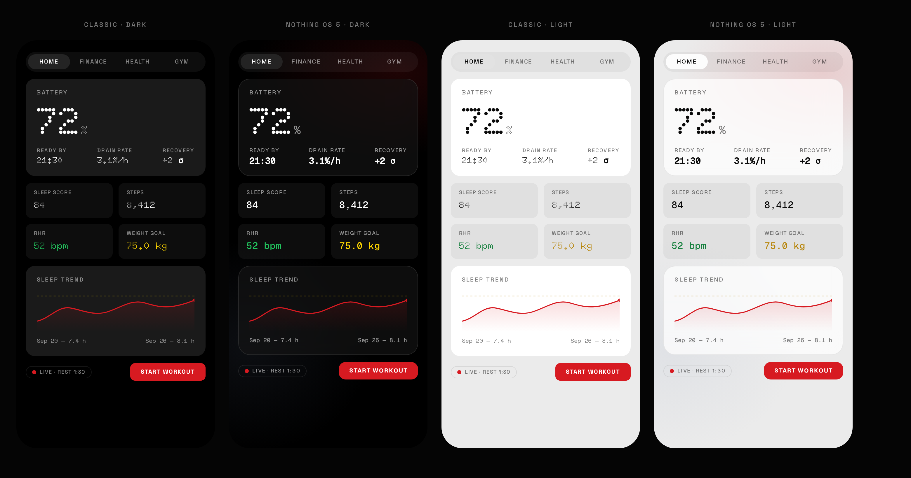
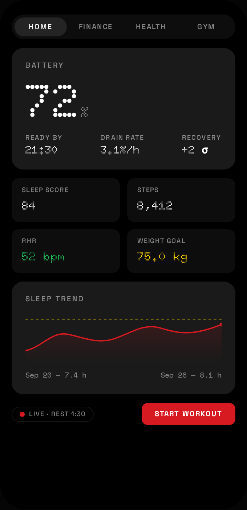
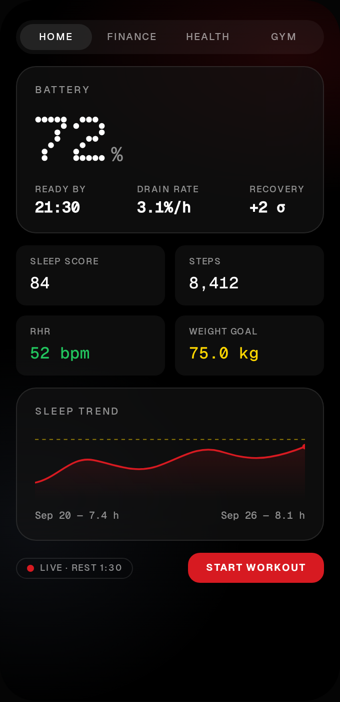

# dashbord Design System — Nothing OS & Nothing OS 5

**Status: authoritative reference.** Two style skins live side by side, exactly
as Nothing itself ships Nothing OS 5.0 (announced 2026-08-25: the OS 5 look is
*an additional theme alongside the classic style*, not a replacement) [official].

**Fact labels:** **[official]** = from Nothing's own materials, or
pixel-measured on a real Nothing OS 5 device (2026-11-14, full 2×2
style×mode matrix). **[impl]** = dashbord implementation choice. The canonical
claim-by-claim spec lives in the `nothing-os-design` skill; this doc carries
everything the app needs plus the settled app-vs-OS deltas (§9).

- Artwork: [`design/theme-comparison.png`](design/theme-comparison.png) (all four variants)
- Interactive mockup: [`design/theme-mockup.html`](design/theme-mockup.html) (open in a browser; tokens mirror `src/theme/variables.css`)
- Per-variant stills: `design/variant-{classic,os5}-{dark,light}.png`



---

## 0. Core vision & design philosophy

A hyper-minimalist, technical command center: raw data, structural honesty,
technical essentialism over decorative UI — an interface that feels like it's
running directly on the hardware [official vision]. Nothing OS 5's update to
that vision: **dot-matrix becomes character, not the workhorse** —
"character rather than compromise readability" [official]; depth comes from a
frosted translucent material instead of flat fills; corners round out. The
monochrome guardrail stays [official].

### The philosophy (in Nothing's designers' own words)

These are the *reasons* behind the rules below. When a rule's letter doesn't
cover a new case, reason from these.

1. **Function first, then play.** "Start from pure functionality and once we
   nail that, we can be more creative with the UI." Get the interaction
   completely right before styling it.
2. **Dare, but selectively.** "The industry isn't daring… if you really want
   to move the wheel, you need to dare." Radical concepts that flopped are
   still wins — they move the industry. But solved patterns (calculator
   keypad, transport controls) stay familiar; innovate one thing, conform
   elsewhere.
3. **Monochrome underneath, color only where it earns its place.** "We have
   this monochrome approach, but then adding color where color is needed."
   Chrome stays black/white/grey; content and *data* may be colored.
4. **Red means alarm, not mood.** "I know red is a strong Nothing color, but
   sometimes it's quite a big alert warning. Nothing has a really good
   secondary yellow that could fit nicely here." Status data gets
   green/amber/red — "that doesn't mean it should be boring" — but the hue
   must be exact.
5. **Dots are a signature, not a default.** "Not everything has to be this
   dot eyespace we're so recognized by." Dot-matrix only where it
   semantically belongs (clocks, readouts); mono fonts for labels/tags, never
   body text; legibility can outrank branding ("I wish this was in NType and
   wasn't in NDot").
6. **Every element must justify its existence.** "Why is it living on the
   home screen? We need to be able to justify our widgets and why we're
   providing them." Filling space is a design smell.
7. **No hand acrobatics.** "Elements that you frequently interact with
   shouldn't live at the top of your screen." Frequent targets live in the
   thumb zone; prefer natural scroll continuation over dead-end buttons.
8. **Motion is information.** Peripheral movement teases attention;
   well-executed physical motion delights; one unexpected micro-interaction
   breaks unthinking taps. Motion must be smooth, purposeful, and respect
   platform limits (battery, refresh).
9. **Precision is the brand.** Matched corner radii, one dot grid, clean left
   edge, centered glyphs, digits that never shift layout. Glanceability =
   consistency — the brain parses consistent labels at a distance.
10. **Design against reality.** Test with bad data; mentally localize every
    string (German/Chinese break layouts); keep screens text-light.
11. **One ecosystem.** App, widgets, and system share navigation, headers,
    and language; full interactive prototypes force the gaps closed.
12. **"Feels like another device."** The highest praise: radical
    single-purpose simplicity that turns the phone into a pager, desk clock,
    calculator. Childlike directness, no ornament.
13. **Co-create, critique mechanically.** Specific, no-ego critique: name the
    exact pixel, radius, label, or gesture that fails — and the principle it
    violates.

Four pillars (app structure): Home (system overview), Health (biometric
calibration), Finance (asset node management), Gym (physical optimization).

---

## 1. The two styles at a glance

| | **Classic (Nothing OS ≤4)** | **Nothing OS 5** |
|---|---|---|
| Body / headings | Space Grotesk | **Geist** [official face] |
| Numerics (tiles, readouts, timers) | Doto (dot-matrix) | **Geist Mono** [official face] |
| Hero display numeral | Doto | **Doto — kept as accent** (`--nt-font-accent-display`) |
| Card material | Flat solid surface (`#1A1A1A`) | **Frosted translucent** (blur 24px + saturate 1.4, hairline border) [impl — extrapolation, see §9] |
| Corner radii | 8 / 16 / 24 px [impl] | **12 / 20 / 28 px** [impl; real OS is smaller, see §9] |
| Dot-grid texture | Visible pattern | Nearly invisible depth cue (4–5% alpha) |
| Red accent | `#D71A21` — unchanged | `#D71A21` — unchanged |
| Data colors (goal gold, positive green) | unchanged | unchanged |
| Motion tokens | unchanged | unchanged |

 

---

## 2. How the skin works (architecture)

Both styles are **pure token swaps** — no page knows which skin is active.

```
<html class="theme-light? theme-os5?">
  :root                    → classic dark tokens (defaults)
  html.theme-light         → light surfaces/ink (existing)
  html.theme-os5           → OS 5 fonts/radii/material (dark)
  html.theme-os5.theme-light → OS 5 light surfaces
```

- State: `useTheme.ts` — two orthogonal axes
  - `mode`: `dark | light | system` (persisted `app_theme`), unchanged
  - `style`: `classic | os5` (persisted `app_theme_style`), toggles `theme-os5`
- OS 5 frost applies to `ion-card` / `.card` globally via
  `backdrop-filter: var(--nt-frost)`. Floating overlays (alerts, action
  sheets, popovers) use the SOLID `--nt-surface-fallback` — blur over the
  dimmed backdrop reads as mud, and text contrast must be guaranteed.
- `@supports not (backdrop-filter…)` → solid fallback. (Capacitor WebView =
  Chromium 130+, always supported; the guard is belt-and-braces.)
- Charts: `chartStyle.ts` ink getters resolve from the html classes — the ink
  triplet is identical in both styles, so charts need no per-style config.
  Canvas font inherits `--ion-font-family`, which flips to Geist in OS 5.

### Token reference (OS 5 deltas only — everything else inherits)

| Token | Classic (dark) | OS 5 (dark) | OS 5 (light) |
|---|---|---|---|
| `--nt-font-body` / `--nt-font-head` | Space Grotesk | Geist | Geist |
| `--nt-font-display` (numerics) | Doto | Geist Mono | Geist Mono |
| `--nt-font-accent-display` | Doto | Doto (hero only) | Doto (hero only) |
| `--nt-font-mono` | Space Mono | Geist Mono | Geist Mono |
| `--nt-tracking-label` / kicker | 0.12em / 0.18em | 0.10em / 0.16em | same (Geist runs wider) |
| `--nt-radius-sm/md/lg` | 8/16/24 | 12/20/28 | 12/20/28 |
| `--nt-surface` | `#1A1A1A` solid | `rgba(20,20,20,.66)` + frost | `rgba(255,255,255,.72)` + frost |
| `--nt-surface-fallback` | — | `#141414` | `#FFFFFF` |
| `--nt-frost` | — | `blur(24px) saturate(1.4)` | same |
| `--nt-border` | ink 8% | white 10% | black 8% |

Full classic/light token values (ink alphas, press accent, data-color light
variants, spacing, motion) live in `src/theme/variables.css`; the canonical
table is the skill's `references/tokens.md`.

**Font licensing:** all faces are SIL OFL 1.1, self-hosted. Geist via
`@fontsource/geist-sans` + `@fontsource/geist-mono` (web) and the same TTFs
decompressed into `android/app/src/main/res/font/geist*.ttf` (native widgets).
Nothing's own NDot/NType/Lettera are proprietary brand assets — never shipped.

---

## 3. Color system

### Foundation [official]

Pure Black `#000000`, Pure White `#FFFFFF`, Window Grey `#B1B3B3` (secondary
text/dividers), N-Grey `#DCD7D2`, `#F4F4F4` (light section backgrounds).
Layout and text only — never accents. In-app: bg `#000000` (true OLED black —
confirmed exact on-device), surfaces `#1A1A1A` / `#242424`, ink hierarchy via
white alphas 100% / 50% / 18% glow (OS 5 dims at 55%) [impl].

### Signal accent [official — the one everyone gets wrong]

- Canonical on-screen red is **`#D71921`** (measured exactly on-device:
  2,860 pure pixels, zero antialiasing). Brand refs cite `#D71920` — one bit
  apart; print primary `#C8102E` is print-only. **dashbord keeps its token
  `#D71A21`** (same family) — do not churn the hex (§9).
- Budget: **0–2 accent elements per screen**, at most one hero signal region
  per screenful — "if two things glow, nothing is signaled" [impl rule].
- Red is for: live/recording, destructive confirm, error/warning thresholds,
  needs-decision badges. **Never** on primary buttons, tabs, links, sliders,
  hover, nav chrome, body text, cards, or empty states.
- Nothing's secondary yellows/blues (`N-Yellow #FFC700`, `N-Blue #002F6C`)
  are the "strong but NOT a warning" marks and data encodings.

### Data colors (semantic, fixed across styles) [impl]

Gold = goal encoding (`#FFD700`; light `#B8860B`), green = positive
(`rgb(34,197,94)`; light `rgb(21,128,61)`). They never paint chrome and are
never repainted by an accent picker; danger stays red even when an expression
accent is another hue.

### Active states — inversion, not color [official]

Classic Nothing does NOT colorize active controls: selected chip/tab/segment
and primary buttons **invert black↔white** (white fill + black text in dark
mode). Measured on device: QS tile ON = `#FFFFFF` + black icon; switch ON =
`#F2F2F2` track + black knob; segment control = greyscale selection. OS 5's
color engine adds an opt-in *expression accent* (wallpaper hue or user-chosen
swatch — measured `#54AEEA / #93A4EB / #EA8BAA`; canonical brand choice
`#FFC700`) that tints control fills, progress, focus rings, and home-layer
icon tints. dashbord does NOT ship an expression accent; inversion is our
treatment in both skins.

### Accent decision table

| Element | Signal red | Active-state treatment |
|---|---|---|
| Switch/toggle ON | never | invert (white track) |
| Slider/progress fill | never | white fill |
| Selected tab / chip / segment | never | invert (white fill) |
| Focus ring | never | ink hairline |
| Destructive confirm | YES | always red |
| Live/recording/sync pulse | YES | red dot |
| Error/warning threshold | YES | red |
| Deload/sickness status glyph | YES (signal) | red |
| Goal/positive data encodings | never | stay gold/green |
| Nav chrome, body text, cards, empty states | never | never |

Mechanics: accent is a token, never a literal; alpha via
`color-mix(in srgb, var(--nt-accent) N%, transparent)`; on-accent text flips
white/black by contrast; never signal with color alone — pair the dot with a
glyph/position/label.

---

## 4. Typography

### Roles

| Role | Classic | OS 5 |
|---|---|---|
| Body / headings | Space Grotesk | Geist |
| Numerics (tiles, timers, readouts) | Doto | Geist Mono |
| Hero display numeral | Doto | Doto — character accent ONLY |
| Mono / fine print | Space Mono | Geist Mono |

Rules:
- Numerals NEVER render in the body face; keep units intact in the dot face
  (`78%` whole; letter units like GB/bpm stay small sans).
- Doto is never body text; in OS 5 additionally never a metric tile or
  readout — hero display only.
- **Doto weight rule:** large dot-matrix type ≈400–500 weight so dots stay
  separate and round; heavy weights smear dots together and pinch curve tops.
  ROND axis up = rounder dots — the Nothing feel is round, not square pixels.
- Uppercase kicker labels with wide tracking (+0.16–0.18em; OS 5: 0.16/0.10em)
  are the signature typographic move.
- Hierarchy comes from size jumps + weight + case, NOT from color —
  non-grey colors are reserved for signal/data.

### App type scale [impl]

Base 16px; label-class text is UPPERCASE + tracking. Key rows: page title
1rem/600/0.12em; card title 1.2rem/600; kicker `.nt-kicker` 0.72rem/400/0.18em
dim; label 0.75rem/500/0.12em dim; metric value display-face 0.95rem+/600/line 1;
chip 0.7rem/500/0.12em; body 0.875rem/400/1.5 dim. Ink: fg 100% → dim 50% →
glow 18% (decoration only, never text at glow alpha; 50% dim ≈ 5.3:1 AA).

Face reference (all verified OFL 1.1): Geist Sans + Geist Mono (Vercel),
Doto (Óliver Lalan, variable wght/ROND), Space Grotesk (Florian Karsten 2018),
Space Mono (Colophon Foundry 2016).

---

## 5. Components

- **Cards:** borderless in Classic (separation = surface contrast alone —
  measured: no hairlines on system pages); in OS 5 exactly ONE hairline
  (`--nt-border`) as the frost edge — not a second accent. No drop shadows
  anywhere; the only glow is the white bloom `0 0 24px rgba(ink,.18)`, never
  colored neon. Headers borderless/shadowless (a toolbar shadow reads as a
  grey band on true black).
- **Buttons (inversion rule):** primary/confirm = solid white (dark) / black
  (light), pill; destructive = solid accent red, white text; cancel/ghost =
  transparent + 1px hairline. Press feedback: scale 0.97 + opacity 0.85,
  140ms — no color flash. Alert buttons: full-width stacked, column-reverse
  (confirm on top), min-height 46.
- **Selection controls:** switch ON = white track/black knob (dark), inverted
  in light; inputs are fill-only (slightly darker than page), focus = ink
  outline, never a colored border; selected action-sheet item = accent text +
  weight 600 or inverted fill — one treatment app-wide.
- **Chips:** pill, hairline, 4×10 padding, uppercase; optional 7px dot INSIDE
  the chip is the one place the signal red legitimately lives (live/degraded).
  Loading pulse: 8px white dot, stepped opacity `steps(4)` — mechanical LED
  feel, never a smooth breathing gradient.
- **Lists/rows:** row min-heights 44–52; separators ≤4% ink or none (prefer
  whitespace + group cards); no zebra striping; leading icons 24dp outline
  1.5-stroke monochrome — never filled/multicolored.
- **Dot-matrix icons:** true 9×9 CSS grids, every lit cell a COMPLETE circle
  (`border-radius: 50%`) — never mask/clip-path/dotted borders (they clip
  dots into partials). Hero/device-grade glyphs: 25×25 grid (Glyph Matrix
  spec), generated from geometric functions.
- **Radii:** cards/sheets = lg; popovers/inputs/list tiles = md–sm;
  buttons/chips = pill. OS 5 sheet: top corners lg, bottom square.

### Motion [impl — matches Nothing's mechanical feel]

- Durations: 140ms micro / 280ms standard / 400ms emphatic. Entrances
  `cubic-bezier(0.2,0,0,1)`; everything else `cubic-bezier(0.4,0,0.2,1)`.
  No springs/bounce/overshoot — motion is mechanical, never springy.
- Animate transform + opacity ONLY. Entrance = fade + 6px rise. Hover =
  opacity drop, never a color change. `prefers-reduced-motion` handled
  globally. Haptic ticks fire only when a scrubbed selection CHANGES.

### Spacing [impl]

4 / 8 / 12 / 16 / 24 / 32 px; cards pad 16, page gutters 16 (24 on ≥600px),
section gaps 24–32; max content width 760px.

---

## 6. Measured on a real Nothing OS 5 device (2026-11-14) [official]

Key facts the app's look is calibrated against (720×1600 screenshots, ≈2px =
1dp, ±15%; full tables in the skill's `references/tokens.md`):

- **One system surface grey:** settings cards, QS tiles, notification cards,
  search bar all render `#1B1B1B` on `#000000` — even with the OS "Translucent"
  style active. The translucent material exists ONLY over the wallpaper;
  **OS 5 never frosts app pages** (→ dashbord's frost is an extrapolation, §9).
- **Geometry is identical across all four style×mode combos** (settings card
  radius 25px ≈ 13dp, rows 88px ≈ 44dp, notification card 26px, QS tile ≈20dp,
  side margin 14dp) — mode changes color, style changes only home panels +
  accent hue. **The real OS card radii are SMALLER than our 12/20/28 scale** (§9).
- **`#D71921` confirmed EXACTLY** (classic timer icon); the OS 5 color engine
  recolors the same icon slot to the wallpaper hue (`#1294D2` on a blue
  wallpaper) — expression accent reaches icon tints on the home layer.
- Light mode inverts per-surface: app pages get darker cards (`#FCFCFC` on
  `#F1F1F1`) but the QS shade gets darker tiles (`#D1D1D1` on `#E2E2E2`).
- Hero page titles on device render in the **NType82 serif typewriter face**;
  functional text is Geist. Dot-matrix numerals appear only where the widget
  IS a clock. (Possible future dashbord accent — §9, do not apply unprompted.)

---

## 7. Theme switcher (Settings → Preferences)

- **Theme:** System / Light / Dark (existing axis)
- **Style:** Nothing OS / Nothing OS 5 (segment control beneath it)

Switching style immediately:
1. re-points every `--nt-*` token (class toggle),
2. pushes `{ themeStyle }` into the native widget snapshot → widgets
   re-render in the new skin within one broadcast.

---

## 8. Native widgets (Android)

Data flow unchanged (JS snapshot → `WidgetData` prefs → providers). Every
pushed snapshot carries an explicit `themeStyle` (`classic`|`os5`);
`WidgetTheme.isOs5(json)` resolves it per render, defaulting to classic on
any missing/garbage value (an old snapshot can never half-theme a widget).

Per provider, two static layouts — picked at inflate time:

| Widget | classic layout | os5 layout | OS 5 deltas |
|---|---|---|---|
| Sleep score | `widget_sleep.xml` | `widget_sleep_os5.xml` | Geist Mono 600 score, Geist labels, panel radius 28 |
| Sleep battery | `widget_sleep_battery.xml` | `widget_sleep_battery_os5.xml` | Geist Mono `%`, ring track lighter (`WidgetTheme.trackColor`) |
| Sleep stages | `widget_sleep_stages.xml` | `widget_sleep_stages_os5.xml` | Geist Mono numerals; timeline stage colors unchanged (data) |
| Briefing | `widget_briefing.xml` | `widget_briefing_os5.xml` | Geist throughout; VU bar unchanged (data) |

- OS 5 panel drawable: `drawable/widget_bg_os5.xml` — `#D9141414`, 28dp
  radius, `#1FFFFFFF` hairline. (True frost isn't possible in RemoteViews;
  translucency + hairline is the honest approximation.)
- Fonts: `res/font/geist.xml` + `res/font/geist_mono.xml` font families.
- **Widget content rules (standing preference):** the visual element
  (bar/grid/ring) is the hero; at most ONE word of text plus a date; the
  visual must FILL the frame (no letterboxing); every widget shrinkable to
  1 cell where the layout allows. Classic + OS5 layout pairs must stay
  geometry-identical — only fonts/colors differ; grep for the sibling layout
  BEFORE editing either.
- **RemoteViews allow-list rule still absolute**: TextView/LinearLayout/
  FrameLayout/ImageView only. Gate before any widget release:
  `grep -n '<View\|<Space' android/app/src/main/res/layout/widget_*.xml`
  must return nothing (mind XML comments containing those strings).

---

## 9. Fact-check deltas vs the real OS (settled — don't "correct" toward the OS)

The skill is the fact-checked base truth; these app deltas are deliberate:

- **Red hex:** canonical measured `#D71921`; app token `#D71A21` is the same
  family — keep it, don't churn the hex.
- **Radii:** the OS5 12/20/28 scale is an app choice — the real OS uses
  smaller card radii (~13dp settings cards, ~20dp QS tiles). Keep 28px-lg
  unless Jernej asks to re-tune.
- **Frost:** real OS 5 never frosts app pages (only wallpaper-backed
  surfaces; settings/QS stay solid `#1B1B1B` on `#000000`). dashbord's OS5
  frost is a deliberate extrapolation — keep it, keep docs labeling it as
  such.
- **Serif hero titles:** real OS 5 hero page titles use the NType82 SERIF
  typewriter face (functional text is Geist). Possible future accent for
  dashbord page titles; do not apply unprompted.

---

## 10. Extending

- **New token?** Add to `:root` (classic default) and re-point in
  `html.theme-os5` / `html.theme-os5.theme-light` if the OS 5 value differs.
  Never hard-code a skin value in a component.
- **New widget?** Classic + OS5 layout pair, same view IDs, register both in
  the provider's layout pick, keep the allow-list rule.
- **New page?** Use tokens + the canonical shared primitives (`.nt-kicker`,
  `.nt-metric-tile`, `.nt-empty`, `.nt-card-topline`, `SectionTabs`,
  `NtProgressRing`, `TrendChart`, `StageBarsChart`) — it is then automatically
  dual-skinned. `NtCard`/`NtMetric` were DELETED as unused wrappers — never
  recreate them or add per-page scoped copies of canonical styles.
- **Before any release:** app-wide visual conformance sweep — grep
  `src/features/` + `src/shared/components/` for raw color literals,
  non-token `font-family`, raw unicode glyphs.
- **Wallpaper-adaptive colour (deferred):** would need a backdrop image source
  inside the app. If ever built: sample 2–3 hues, tint ONLY chips/segment
  fills/control state, keep text/surfaces monochrome — Nothing's own
  guardrail. A user-CHOSEN accent hue (swatch picker) is the no-wallpaper
  variant of the same OS 5 mechanism; same rules, only the source differs.
